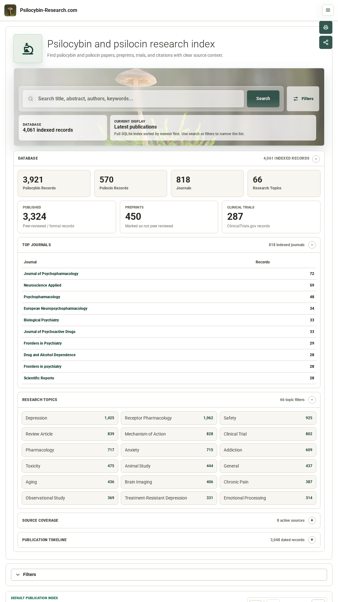
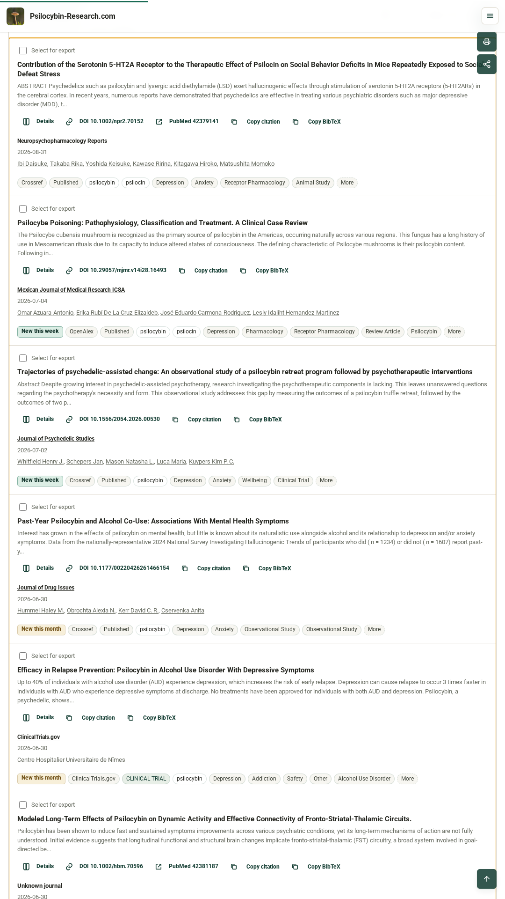
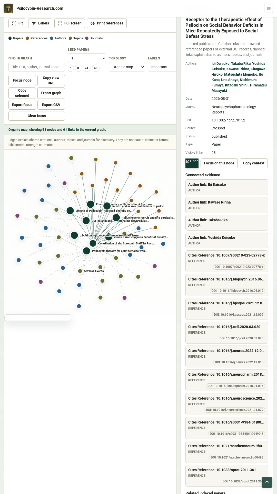

<p align="center">
  <a href="https://psilocybin-research.com/">
    
  </a>
</p>

<h1 align="center">Psilocybin Research Tracker</h1>

<p align="center">
  A self-contained research application for discovering, evaluating, and citing psilocybin and psilocin literature.
</p>

<p align="center">
  <a href="https://psilocybin-research.com/">Live application</a>
  ·
  <a href="https://psilocybin-research.com/about.php">About</a>
  ·
  <a href="https://psilocybin-research.com/api.php">API</a>
  ·
  <a href="docs/getting-started.md">Documentation</a>
  ·
  <a href="https://doi.org/10.5281/zenodo.21293525">Dataset</a>
</p>

<p align="center">
  <a href="https://github.com/psilocybin-research/psilocybin-research-tracker/actions/workflows/ci.yml"></a>
  <a href="LICENSE"></a>
  <a href="CITATION.cff"></a>
  
  
  
</p>

<p align="center">
  
  
  
</p>

The tracker helps researchers, clinicians, journalists, policy analysts, and advanced public readers find and monitor relevant literature while retaining scientific context such as source database, publication status, persistent identifiers, journal, authors, date, study type, and provenance.

## Highlights

| Area | Capabilities |
| --- | --- |
| Discovery | Full-text metadata search with author, journal, topic, date, source, status, study-type, and substance filters |
| Evidence context | Explicit labels for publications, preprints, protocols, reviews, and clinical-trial registrations |
| Citation workflow | BibTeX, RIS, CSV, JSON, LaTeX, citation copying, DOI and PubMed links |
| Research exploration | Analytics, author pages, evidence pages, related records, and an interactive citation network |
| Monitoring | Double opt-in email alerts and Web Push notifications |
| Reuse | Public API, embeddable widgets, rights-safe SQLite download, R toolkit, PWA, and Android TWA source |

## Quick Start

Requirements: PHP 8.2 or newer with PDO SQLite, Node.js 20 or newer, and npm.

```bash
git clone https://github.com/psilocybin-research/psilocybin-research-tracker.git
cd psilocybin-research-tracker
npm ci
npm run build
php -S 127.0.0.1:8073 -t .
```

Open `http://127.0.0.1:8073/`. The first request initializes a local SQLite database from `schema.sql`. To retrieve records from the configured public sources, run:

```bash
php bin/update.php --daily
```

Historical backfills can make many external API requests. Review [Getting Started](docs/getting-started.md) and [Data Sources](docs/data-sources.md) before running `php bin/update.php --backfill`.

## Documentation

- [Getting started and local configuration](docs/getting-started.md)
- [Application architecture](docs/architecture.md)
- [Sources, normalization, and deduplication](docs/data-sources.md)
- [API, exports, widgets, and SQLite download](docs/api.md)
- [Code and data rights](docs/data-rights.md)
- [Deployment guidance](docs/deployment.md)
- [Updates, backups, alerts, and health monitoring](docs/operations.md)
- [Android / Google Play wrapper](android/README.md)
- [Contributing](CONTRIBUTING.md), [support](SUPPORT.md), and [security](SECURITY.md)

## Public and Private Data Boundary

The private runtime database retains source text and importer payloads needed for matching, classification, deduplication, and curation. Public pages, APIs, exports, widgets, and downloadable SQLite files use a rights-safe projection that does not redistribute unverified abstracts, registry descriptions, source-derived keywords, or unrestricted payloads.

Runtime databases, logs, subscriptions, credentials, private keys, backups, signing material, and manuscript working files are intentionally excluded from this repository. See [Code and Data Rights](docs/data-rights.md) for the licensing boundary.

## Citation

Use GitHub's **Cite this repository** control or [CITATION.cff](CITATION.cff) for the software.

The latest public dataset version is available through the Zenodo concept DOI: [10.5281/zenodo.21293525](https://doi.org/10.5281/zenodo.21293525). The fixed v1.0.6 dataset snapshot is [10.5281/zenodo.21333043](https://doi.org/10.5281/zenodo.21333043) and corresponds to software release v2.1.2. Later application releases do not replace that fixed snapshot's recorded software version.

## License

Source code is licensed under the [MIT License](LICENSE). That license does not relicense third-party bibliographic or registry metadata. Dataset-specific rights are described in [docs/data-rights.md](docs/data-rights.md) and in each Zenodo deposit.
