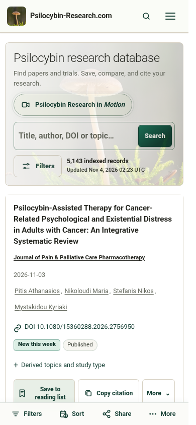
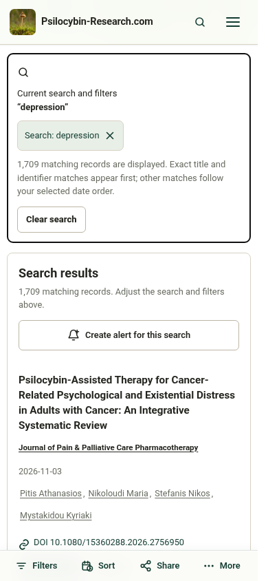
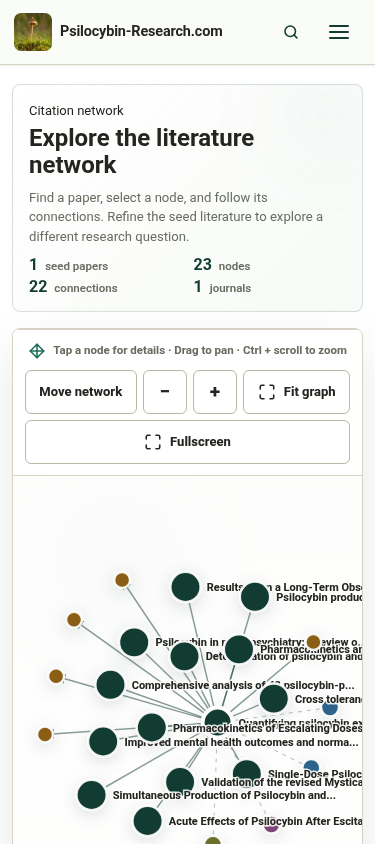

<p align="center">
  <a href="https://psilocybin-research.com/">
    
  </a>
</p>

<h1 align="center">Psilocybin Research Tracker</h1>

<p align="center">
  A self-contained research application for discovering, evaluating, and citing psilocybin and psilocin literature.
</p>

<p align="center">
  <a href="https://psilocybin-research.com/">Live application</a>
  ·
  <a href="https://psilocybin-research.com/about.php">About</a>
  ·
  <a href="https://psilocybin-research.com/api.php">API</a>
  ·
  <a href="docs/getting-started.md">Documentation</a>
  ·
  <a href="https://doi.org/10.5281/zenodo.21293525">Dataset</a>
</p>

<p align="center">
  <a href="https://github.com/psilocybin-research/psilocybin-research-tracker/actions/workflows/ci.yml"></a>
  <a href="LICENSE"></a>
  <a href="CITATION.cff"></a>
  
  
  
</p>

<p align="center">
  
  
  
</p>

The tracker helps researchers, clinicians, journalists, policy analysts, and advanced public readers find and monitor relevant literature while retaining scientific context such as source database, publication status, persistent identifiers, journal, authors, date, study type, and provenance.

## Highlights

| Area | Capabilities |
| --- | --- |
| Discovery | Full-text metadata search with author, journal, topic, date, source, status, study-type, and substance filters |
| Evidence context | Explicit labels for publications, preprints, protocols, reviews, and clinical-trial registrations |
| Citation workflow | BibTeX, RIS, CSV, JSON, LaTeX, citation copying, DOI and PubMed links |
| Research exploration | Analytics, author pages, evidence pages, related records, and an interactive citation network |
| Monitoring | Double opt-in email alerts and Web Push notifications |
| Reuse | Public API and read-only MCP connector, embeddable widgets, rights-safe SQLite download, R toolkit, PWA |

## Public database and AI access

The [live research application](https://psilocybin-research.com/) provides full public metadata, search/filter APIs, trial facts, citations, research networks and reproducible exports. Titles and years are one export example, not the platform's scope.

- [Access guide (HTML)](https://psilocybin-research.com/for-ai.html), [plain text](https://psilocybin-research.com/for-ai.txt), [versioned Markdown guidance](docs/research-agent-guide.md), and [raw GitHub guide fallback](https://raw.githubusercontent.com/psilocybin-research/psilocybin-research-tracker/main/docs/research-agent-guide.md). The raw mirror is served as plain text for tools that cannot fetch the website guides or consume Markdown content types.
- [Full public SQLite database](https://psilocybin-research.com/database.php), [full metadata CSV](https://psilocybin-research.com/api/v1/papers?format=csv&limit=50000), and [full public metadata JSON](https://psilocybin-research.com/export.php?format=json&limit=50000).
- **[Read-only MCP connector](https://psilocybin-research.com/mcp)** — remote Streamable HTTP, no authentication. Fourteen tools cover compatible `search`/`fetch`, filtered publication/trial search, citations, explicit DOI relationships, annual counts, verified dataset downloads and a fixed transcriptomics reanalysis. [Connection instructions and limits](https://psilocybin-research.com/for-ai.html#connect-using-mcp). Direct browser GET returns 405 by design; use an MCP client.
- [Transcriptomics MCP module](docs/transcriptomics-mcp.md): gene results, pathway sensitivities, both CAMERA settings and all ten Bayesian model summaries from the fixed Zenodo v1.2.0 archive.
- [Official MCP Registry listing](https://registry.modelcontextprotocol.io/v0.1/servers/com.psilocybin-research%2Fresearch/versions/latest) — domain-verified remote server `com.psilocybin-research/research`; [registry metadata](server.json). This listing is separate from ChatGPT/Claude plugin directories; add the custom connection where your client/account permits it.
- [Verified dataset manifest](https://psilocybin-research.com/dataset-manifest.json): completed download files from one source snapshot, with exact byte sizes, SHA-256 checksums and record counts. Includes SQLite, compressed SQLite-XZ, RDS-XZ data frames, CSV, JSON, citation formats, a reproducible bundle, compact catalogue, TXT, annual statistics and selected reviewed study relationships. Keep downloaded files: the latest three snapshots are retained.
- [Annual publication statistics API](https://psilocybin-research.com/api/v1/statistics/publications-by-year) and [CSV](https://psilocybin-research.com/api/v1/statistics/publications-by-year?format=csv): year/status totals, with missing years separate and current-year coverage marked partial. Counts describe indexed records, not independent studies.
- [Search API](https://psilocybin-research.com/api/v1/papers?per_page=100&page=1) and [OpenAPI specification](https://psilocybin-research.com/docs/research-api.openapi.json).
- [Complete compact directory](https://psilocybin-research.com/catalogue.php) and [titles/years TXT](https://psilocybin-research.com/catalogue.php?format=txt). The directory contains every visible record with a smaller field set, not all database columns.

These URLs describe the current deployed service; a repository checkout or earlier release may have a different endpoint set. Both `/api/v1/papers` and the existing `/api.php?resource=papers` are valid live routes. Keep publication status, source identifiers and provenance; unknown years stay unknown. Verify returned totals before claiming completeness. The compact JSON supplies `complete`, `record_count`, `total_records` and UTC generation time.

The [public research access workflow](.github/workflows/research-access.yml) runs daily and on demand using `python3 bin/check-research-access.py` and `python3 bin/check-mcp-access.py`. It downloads and checks the published files, reconciles annual counts against public SQLite, checks documentation response types, and exercises the public MCP lifecycle, all fourteen tools and four listed resources. This tests ordinary external HTTP access; it does not guarantee access from every AI provider’s restricted execution environment.

If a tool rejects Markdown, use HTML or plain text. If Python cannot resolve the host, try an available browser tool or a user-attached download. Do not reconstruct an exhaustive catalogue from snippets. Public metadata access excludes private runtime state, source-derived abstracts and full texts.

## Quick Start

Requirements: PHP 8.2 or newer with PDO SQLite, Node.js 20 or newer, and npm.

```bash
git clone https://github.com/psilocybin-research/psilocybin-research-tracker.git
cd psilocybin-research-tracker
npm ci
npm run build
php -S 127.0.0.1:8073 -t .
```

Open `http://127.0.0.1:8073/`. The first request initializes a local SQLite database from `schema.sql`. To retrieve records from the configured public sources, run:

```bash
php bin/update.php --daily
```

Historical backfills can make many external API requests. Review [Getting Started](docs/getting-started.md) and [Data Sources](docs/data-sources.md) before running `php bin/update.php --backfill`.

## Documentation

- [Getting started and local configuration](docs/getting-started.md)
- [Application architecture](docs/architecture.md)
- [Sources, normalization, and deduplication](docs/data-sources.md)
- [API, exports, widgets, and SQLite download](docs/api.md)
- [Code and data rights](docs/data-rights.md)
- [Deployment guidance](docs/deployment.md)
- [Updates, backups, alerts, and health monitoring](docs/operations.md)
- [Contributing](CONTRIBUTING.md), [support](SUPPORT.md), and [security](SECURITY.md)

## Public and Private Data Boundary

The private runtime database retains source text and importer payloads needed for matching, classification, deduplication, and curation. Public pages, APIs, exports, widgets, and downloadable SQLite files use a rights-safe projection that does not redistribute unverified abstracts, registry descriptions, source-derived keywords, or unrestricted payloads.

Runtime databases, logs, subscriptions, credentials, private keys, backups, signing material, and manuscript working files are intentionally excluded from this repository. See [Code and Data Rights](docs/data-rights.md) for the licensing boundary.

## Citation

Use GitHub's **Cite this repository** control or [CITATION.cff](CITATION.cff) for the software.

The latest public dataset version is available through the Zenodo concept DOI: [10.5281/zenodo.21293525](https://doi.org/10.5281/zenodo.21293525). The fixed v1.0.6 dataset snapshot is [10.5281/zenodo.21333043](https://doi.org/10.5281/zenodo.21333043) and corresponds to software release v2.1.2. Later application releases do not replace that fixed snapshot's recorded software version.

## License

Source code is licensed under the [MIT License](LICENSE). That license does not relicense third-party bibliographic or registry metadata. Dataset-specific rights are described in [docs/data-rights.md](docs/data-rights.md) and in each Zenodo deposit.

[Reviewed study-family links](https://psilocybin-research.com/api/v1/study-links) distinguish selected protocols, registrations, primary reports and follow-ups using exact source evidence; coverage is incomplete. The [dated fresh-session benchmark](docs/research-task-benchmark.json) records real model-tool task results and network limitations.

## Image credit

Mushroom photograph: **Jürgen Liebherr (jggrz), used with permission**. [Original photograph](https://pixabay.com/photos/mushroom-helmling-moss-tap-forest-8512804/) · [Photographer](https://pixabay.com/users/jggrz-7998824/). Cropped/resized for the project’s logo, app icons and backgrounds. The software MIT licence does not relicense this photograph.
